# PRAHAAR — प्रहार
## AI-Powered Intelligent Border Surveillance & Command Platform

[](https://github.com/harshit25bce10223-eng/IBVAP-PRAHAAR)
[](https://fastapi.tiangolo.com)
[](https://react.dev)
[](https://vitejs.dev)
[](https://tailwindcss.com)
[](#)
[](https://www.sih.gov.in)

---

**PRAHAAR** (Intelligent Border Video Analytics Platform — IBVAP) is an integrated next-generation command & control solution engineered for frontier border defense (SSB — Sashastra Seema Bal). It delivers **real-time threat perception**, **multi-camera AI tracking**, **tamper-proof forensic evidence ledger**, **dynamic polygon virtual fencing**, and **explainable multi-factor risk evaluation** — all inside a single operational workspace.

---

## 📸 Platform Screenshots

### 🗺️ Command Dashboard & GIS Digital Twin

| Command Overview Dashboard | GIS / Digital Twin Perimeter Map |
|:---:|:---:|
| 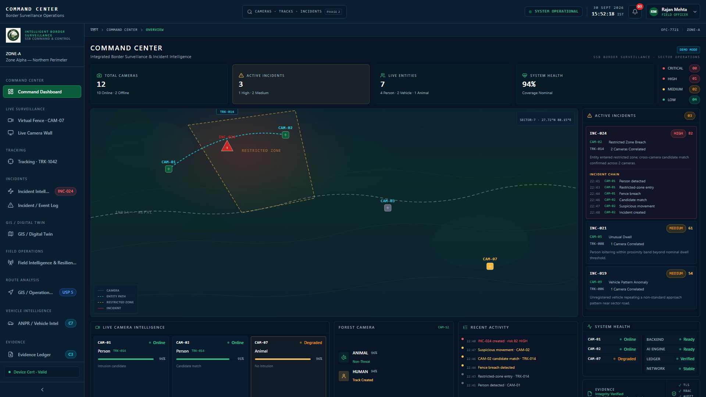 | 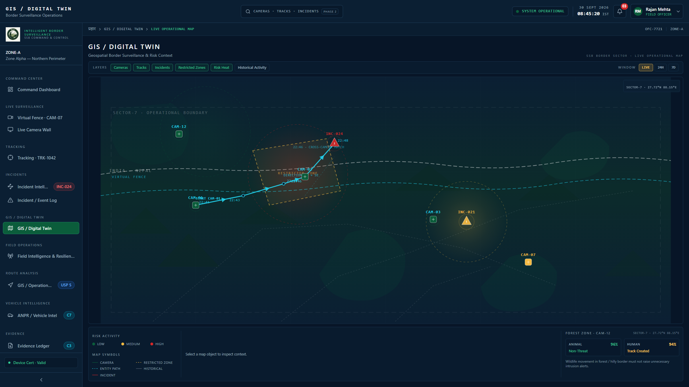 |

> Real-time operational command centre with threat queue, risk indicators, and active zone status. The GIS Digital Twin renders live zone polygons, camera FOV coverage, and sector topology on an interactive tactical map.

---

### 🚧 Virtual Fence & Risk Engine (Component 1)

| Virtual Fence — CAM-07 Live | Virtual Fence — Zone B Inspection (CAM-12) |
|:---:|:---:|
|  | 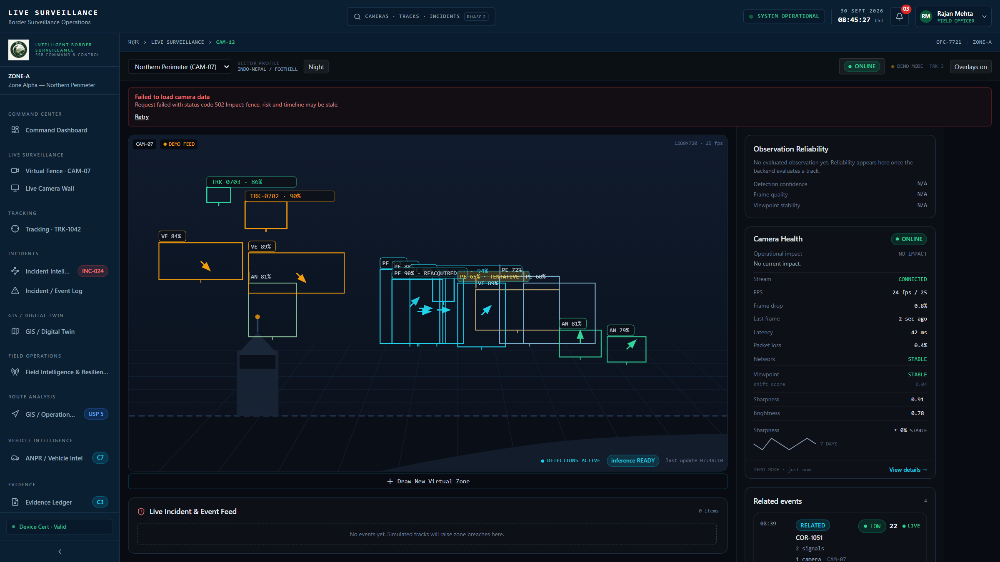 |

| Incident Intelligence — Priority Queue | Incident Detail — Decision Support Dossier |
|:---:|:---:|
| 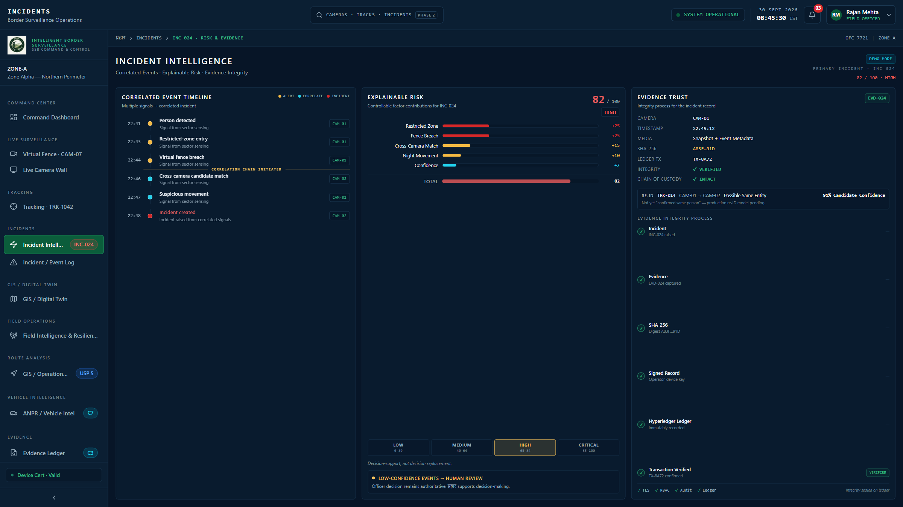 | 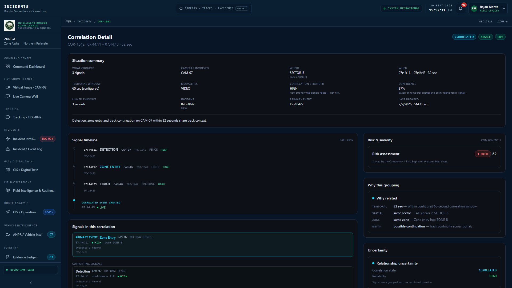 |

> Multi-polygon virtual fence engine with deterministic boundary computation. Configurable dwell thresholds, buffer zones, and restricted areas. Explainable risk scores (0–100) broken down by intrusion zone sensitivity, time-of-day, entity class, confidence, and multi-camera confirmation. Signal timeline correlates detection → zone entry → track continuation into incident dossiers.

---

### 📷 Camera Health & Surveillance Wall (Component 2)

| Camera Health & Quality Matrix | Live Surveillance Camera Wall |
|:---:|:---:|
| 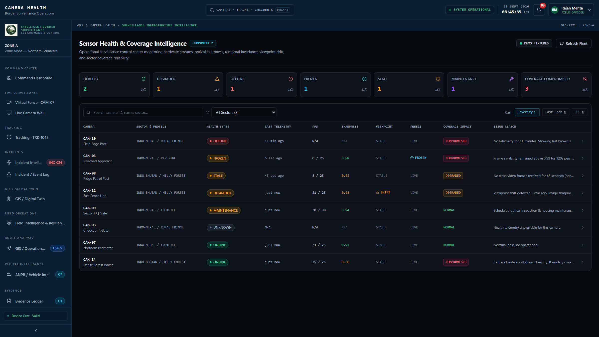 | 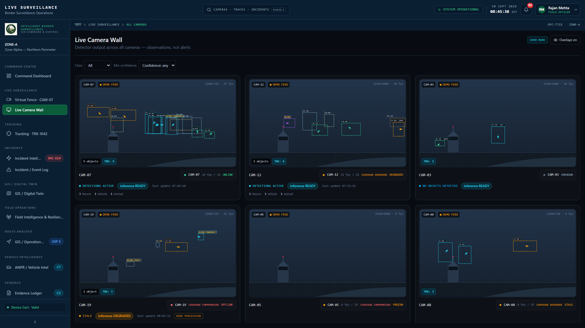 |

> Per-camera health scoring with occlusion detection, defocus alerts, viewpoint shift verification, illumination regime monitoring, and dynamic baseline tracking. The multi-view camera wall shows simultaneous feeds from all operational sensors.

---

### 🔐 Evidence & Tamper-Evident Ledger (Component 3)

| Evidence Workspace & Ledger Table | Evidence Detail — Provenance Chain |
|:---:|:---:|
| 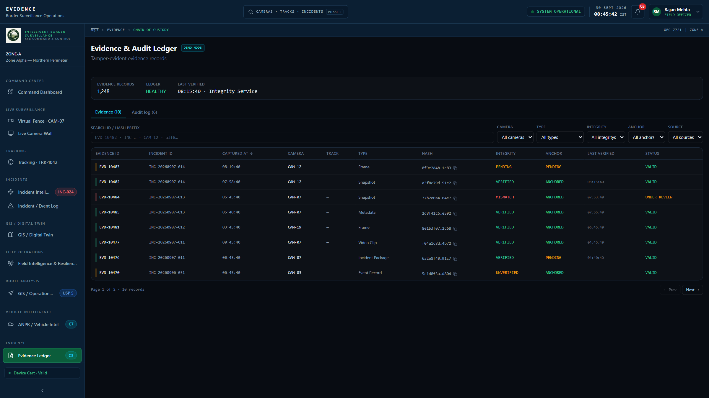 | 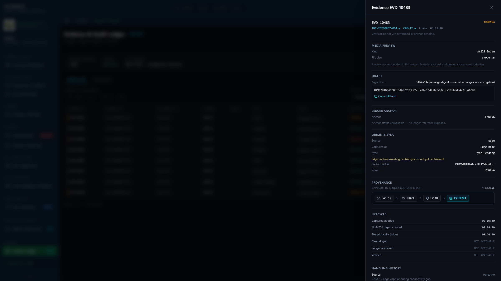 |

| Immutable Audit Log Trail | |
|:---:|:---:|
| 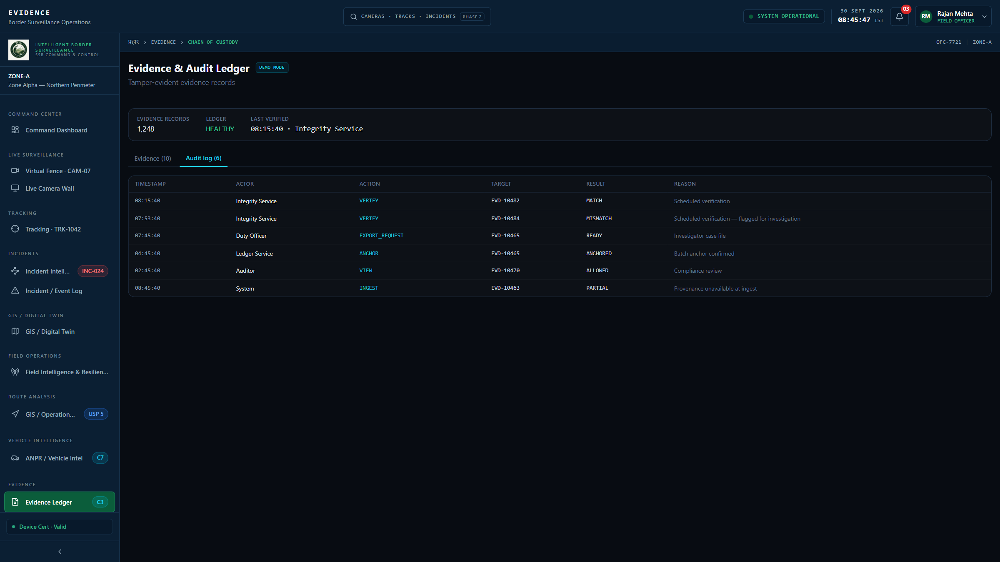 | |

> Append-only cryptographic evidence ledger. Every evidence record carries SHA-256 hash, verification history, lifecycle state machine (CREATED → HASHED → VERIFIED → ARCHIVED), provenance chain, and full custody log. MISMATCH detection is visually unmistakable. Backend remains the sole verification authority.

---

### 🔗 Event Correlation & Chronology (Component 4)

| Events Exploration & Telemetry Stream | Correlation Detail — Signal Timeline |
|:---:|:---:|
| 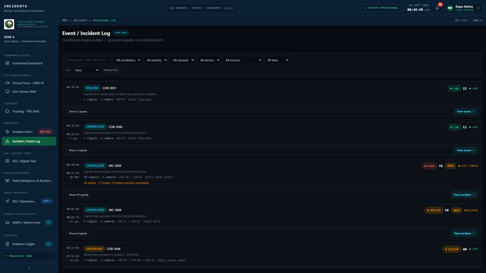 |  |

> Multi-signal correlation engine groups detection, zone entry, and track signals within configurable temporal windows. Each correlation group exposes strength score, spatial/temporal/entity reasoning, linked incident, and uncertainty analysis.

---

### 🎯 Multi-Object Tracking Engine (Component 6)

| Track Detail — TRK-1042 Telemetry & Trajectory |
|:---:|
| 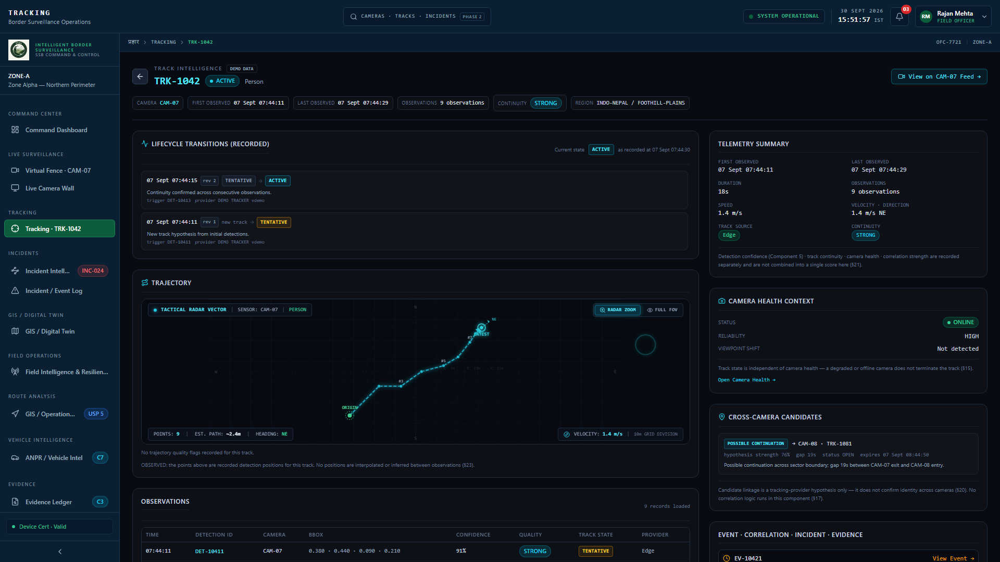 |

> Per-track telemetry including lifecycle transitions (TENTATIVE → ACTIVE), observation table with detection IDs and bounding boxes, trajectory visualization, camera health context, and cross-camera continuation candidates. Fully independent from risk scoring (C1) and correlation (C4).

---

### 🚗 ANPR / Vehicle Intelligence (Component 7)

| ANPR Sightings & Plate Search | Camera Vehicle Traffic Checkpoint (CAM-07) |
|:---:|:---:|
| 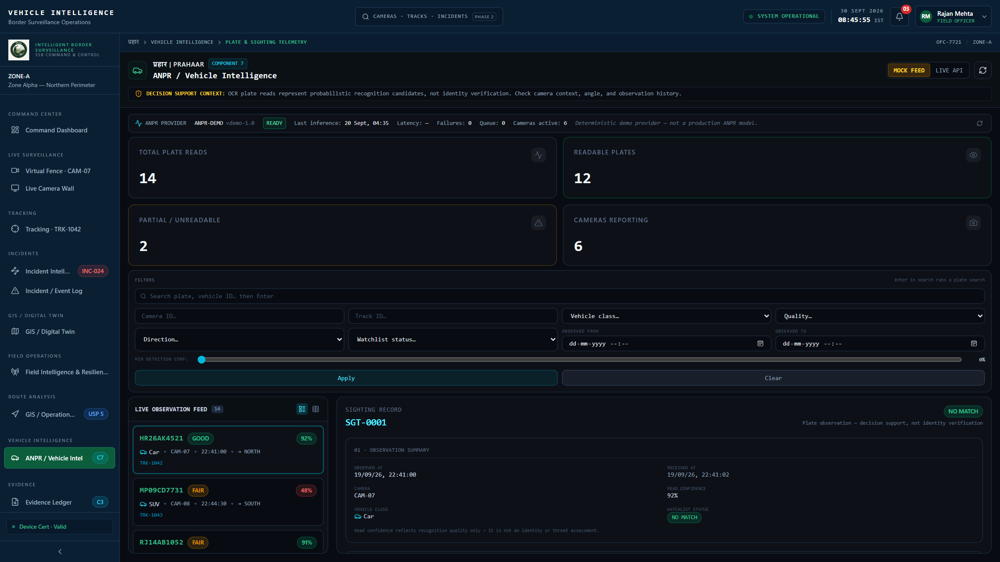 | 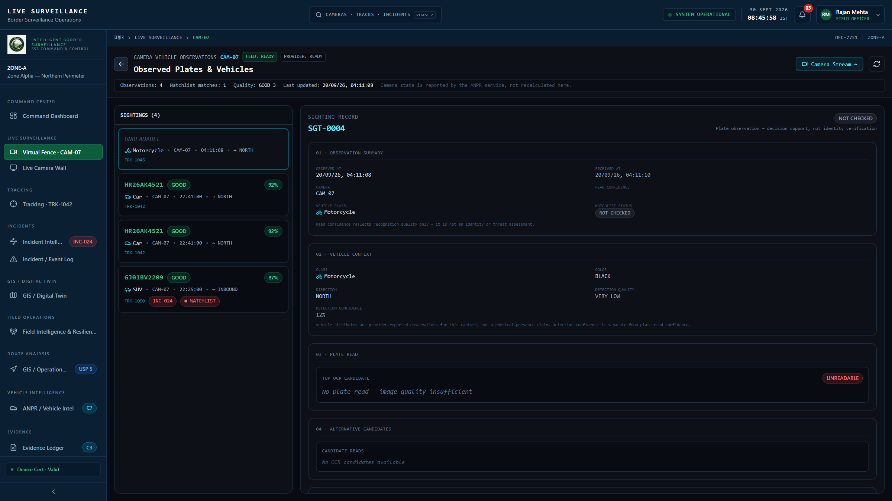 |

| Vehicle Movement History Dossier (VEH-A001 / HR26AK4521) | |
|:---:|:---:|
| 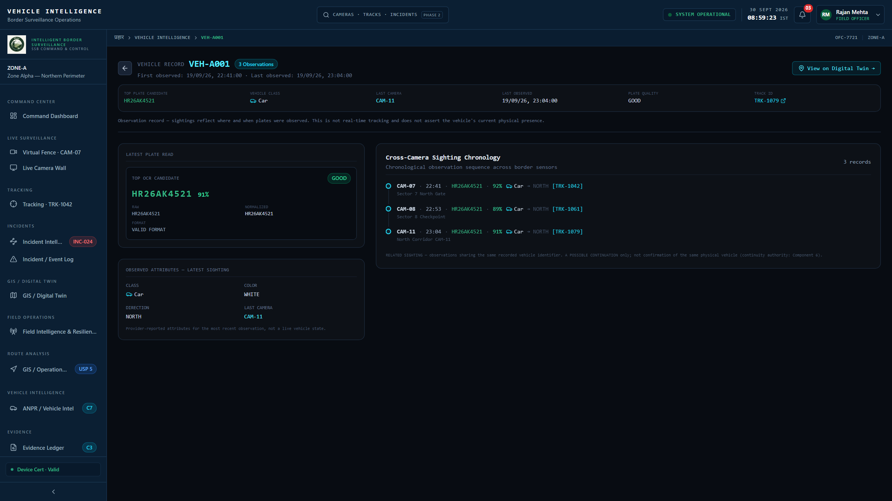 | |

> License plate OCR with confidence scoring, plate quality assessment, and format validation. Cross-camera sighting chronology reconstructs vehicle movement across sector boundary sensors. Watchlist integration surfaces flagged vehicles instantly.

---

### 🛡️ Tactical Field Intelligence & Route Analysis

| Field Intelligence & Patrol Coordination | Sector Route Risk & Vulnerability Analysis |
|:---:|:---:|
| 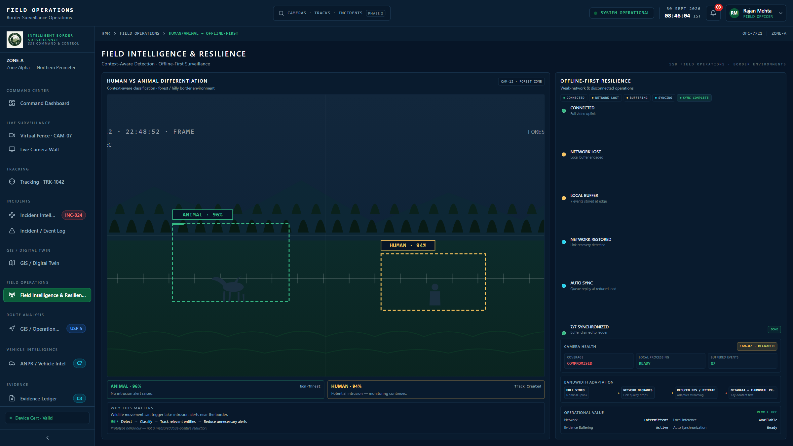 | 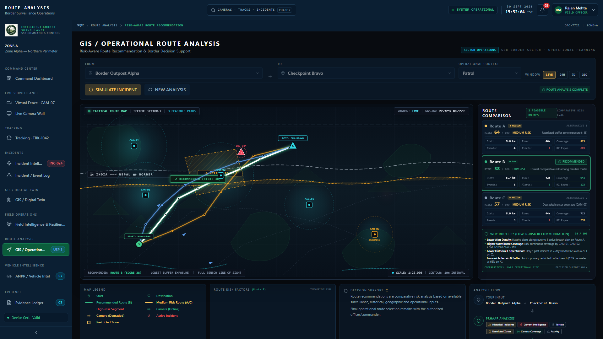 |

> Sector-level patrol coordination with unit positioning, resource tracking, and field status dashboards. Route analysis overlays risk profiles, vulnerability assessments, and tactical recommendations across operational sectors.

---

### 🔒 Authentication & Command Console Access

| Command Console Login & Security Gateway |
|:---:|
| 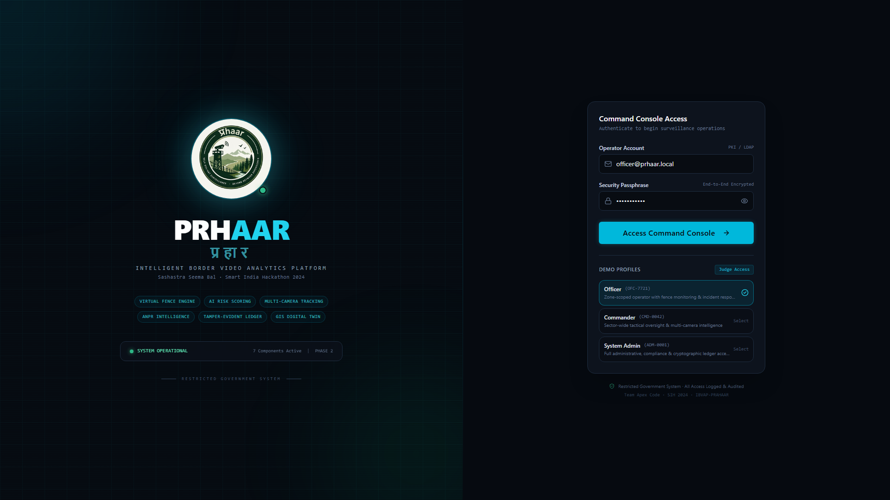 |

> Restricted command console with role-based PKI/LDAP authentication, judge demo profiles, end-to-end encryption, and full PRAHAAR branding with official SSB insignia.

---

## ⚡ Key Architectural Capabilities

| # | Component | Capability |
|---|-----------|-----------|
| **C1** | Virtual Fence & Risk Engine | Polygon boundary engine, multi-factor explainable risk scoring, incident lifecycle management |
| **C2** | Camera Health & Coverage Intel | Per-sensor health scoring, occlusion/defocus/viewpoint shift detection, dynamic baseline |
| **C3** | Evidence & Tamper-Evident Ledger | SHA-256 ledger, append-only chain, lifecycle state machine, provenance & custody |
| **C4** | Event Correlation & Situation Engine | Multi-signal temporal correlation, strength scoring, uncertainty analysis |
| **C5** | Detection Intelligence | Frame-level detection records, class/quality/confidence, event linkage |
| **C6** | Multi-Object Tracking Engine | Cross-camera track association, telemetry, trajectory, lifecycle transitions |
| **C7** | ANPR / Vehicle Intelligence | Plate OCR, confidence/quality scoring, cross-camera movement reconstruction |

---

## 📂 Repository Structure

```
IBVAP-PRAHAAR/
├── START_PRAHAAR.bat         # 1-Click launcher (CMD)
├── START_PRAHAAR.ps1         # 1-Click launcher (PowerShell)
├── docs/
│   └── screenshots/          # 19 platform screenshots (1920×1080)
├── images/                   # Project branding assets
│   └── logo.jpg
├── ibvap-backend/            # FastAPI Python Backend
│   ├── app/
│   │   ├── api/              # REST API routers (C1–C7 + evidence + audit)
│   │   ├── models/           # SQLAlchemy ORM models
│   │   ├── schemas/          # Pydantic v2 request/response schemas
│   │   ├── services/         # Business logic & domain services
│   │   └── main.py           # ASGI application entry point
│   ├── alembic/              # Database migrations
│   ├── tests/                # 391 backend tests (pytest)
│   └── requirements.txt
└── ibvap-frontend/           # React 18 + TypeScript + Vite Frontend
    ├── src/
    │   ├── components/       # Reusable UI components (per-component)
    │   ├── pages/            # Route-level page components
    │   ├── services/         # API service layer (real + mock modes)
    │   ├── store/            # Zustand global state
    │   ├── hooks/            # Custom React hooks
    │   └── types/            # TypeScript domain types
    ├── tests/                # 132 frontend tests (Vitest)
    └── vite.config.ts
```

---

## 🚀 Quick Start

### Prerequisites
- **Python 3.10+**
- **Node.js 18+** & **npm**

### Option 1: One-Click Launch (Windows)
```powershell
.\START_PRAHAAR.ps1
```
Auto-configures venv, installs all dependencies, and launches both backend and frontend servers.

### Option 2: Manual Setup

#### Backend
```bash
cd ibvap-backend
python -m venv venv
venv\Scripts\activate          # Windows
pip install -r requirements.txt
python -m uvicorn app.main:app --host 0.0.0.0 --port 8000 --reload
```
- API: `http://localhost:8000`
- Swagger Docs: `http://localhost:8000/docs`

#### Frontend
```bash
cd ibvap-frontend
npm install
npm run dev
```
- Web App: `http://localhost:5173`

#### Demo Login
```
Email:    officer@prhaar.local
Password: Officer@123
```

---

## 🛡️ Tech Stack

| Layer | Technology |
|-------|-----------|
| **Backend** | FastAPI, SQLAlchemy, SQLite, Alembic, Pydantic v2, PyTest |
| **Frontend** | React 18, TypeScript, Vite, TailwindCSS, Zustand, Lucide Icons, React Router |
| **Integrity** | SHA-256 cryptographic hashing, append-only ledger, tamper detection |
| **AI/ML** | Multi-factor risk engine, cross-camera association, plate OCR confidence scoring |
| **Security** | CORS guard, session-based auth, device certificate binding |

---

## 📊 Test Coverage

| Suite | Tests | Status |
|-------|-------|--------|
| Backend (pytest) | **391** | ✅ All passing |
| Frontend (Vitest) | **132** | ✅ All passing |

---

## 👥 Authors & Team

**Team Apex Code** — Smart India Hackathon (SIH) 2024
