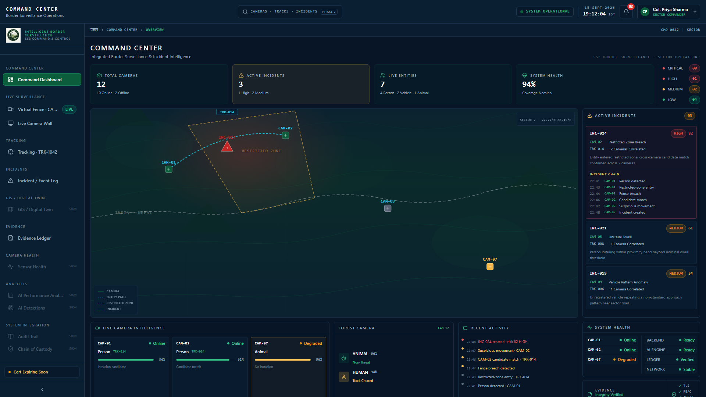

# PRAHAAR — AI-Powered Intelligent Border Surveillance & Command Platform

[](https://github.com/harshit25bce10223-eng/IBVAP-PRAHAAR)
[](https://fastapi.tiangolo.com)
[](https://react.dev)
[](https://vitejs.dev)
[](https://tailwindcss.com)

**PRAHAAR** (Intelligent Border Video Analytics Platform — IBVAP) is an integrated next-generation command and control solution engineered for frontier border defense (SSB - Sashastra Seema Bal). It delivers real-time threat perception, multi-camera tracking, tamper-proof forensic evidence logging, dynamic polygon virtual fencing, and explainable multi-factor risk evaluation.

---

## 📸 Platform Overview & Visuals

| Dashboard Overview | Virtual Fencing |
| :---: | :---: |
|  |  |

| Digital Twin & Tactical Map | Camera Wall & Real-time Feeds |
| :---: | :---: |
|  |  |

| Evidence Risk & Tamper Ledger | Field Intelligence & Patrols |
| :---: | :---: |
|  |  |

---

## ⚡ Key Architectural Capabilities

1. **Virtual Fencing & Spatial Analysis**:
   - Deterministic polygon boundary computation with inclusive and exclusive boundary policies.
   - Dynamic buffer and zero-tolerance restricted zones with configurable dwell thresholds and active schedules.

2. **Explainable Risk Scoring Engine**:
   - Multi-factor risk calculation incorporating intrusion zone sensitivity, temporal factors (night-time weighting), multi-camera confirmation, entity classification (Human, Vehicle, Animal), and model confidence.
   - Transparent scoring breakdown with severity tiers: Low, Medium, High, and Critical.

3. **Camera Health & Field Sensor Monitoring**:
   - Dynamic baseline tracking, occlusion detection, defocusing alerts, viewpoint shift verification, and illumination regime monitoring.

4. **Multi-Camera AI Tracking & ANPR**:
   - Cross-camera track association, trajectory reconstruction, speed estimation, and vehicle license plate recognition.

5. **Tamper-Evident Evidence Ledger**:
   - Cryptographic verification of recorded evidence, immutable chain-of-custody tracking, and hash ledger audits.

6. **Interactive Tactical UI (Frontend)**:
   - Command wall, digital twin map view, automated alert notifications, threat analytics, and responsive incident investigation drawers.

---

## 📂 Repository Structure

```
├── START_PRAHAAR.bat         # Universal 1-Click launcher (CMD)
├── START_PRAHAAR.ps1         # Universal launcher script (PowerShell)
├── package.json              # Workspace root package definition
├── images/                   # Project branding assets
│   └── logo.jpg
├── ibvap-backend/            # FastAPI Python Backend
│   ├── alembic.ini           # Database migration configuration
│   ├── app/                  # Application core, API routes, models, schemas, and services
│   ├── evidence_storage/     # Storage vault for forensic evidence
│   ├── requirements.txt      # Python dependencies
│   ├── scripts/              # Seed and maintenance scripts
│   └── tests/                # Unit and integration test suite
└── ibvap-frontend/           # React + TypeScript + Vite Frontend
    ├── src/                  # Components, pages, hooks, state store, and services
    ├── docs/screenshots/     # UI Screenshots and documentation assets
    ├── package.json          # Frontend dependencies and scripts
    └── vite.config.ts        # Vite configuration
```

---

## 🚀 Quick Start Guide

### Prerequisites
- **Python 3.10+**
- **Node.js 18+** & **npm**

### Option 1: One-Click Launch (Windows)
Double-click `START_PRAHAAR.bat` or run:
```powershell
.\START_PRAHAAR.ps1
```
This script will automatically configure Python venv, install pip packages, install npm dependencies, and launch both backend and frontend servers.

---

### Option 2: Manual Setup

#### 1. Backend Setup
```bash
cd ibvap-backend
python -m venv venv

# Windows
venv\Scripts\activate
# Linux/macOS
# source venv/bin/activate

pip install -r requirements.txt
python -m uvicorn app.main:app --host 0.0.0.0 --port 8000 --reload
```
- API Server: `http://localhost:8000`
- Swagger Interactive Docs: `http://localhost:8000/docs`

#### 2. Frontend Setup
```bash
cd ibvap-frontend
npm install
npm run dev
```
- Frontend Web App: `http://localhost:5173`

---

## 🛡️ Tech Stack

- **Backend**: FastAPI, SQLAlchemy, SQLite/AsyncIO, Alembic, Pydantic v2, PyTest
- **Frontend**: React 18, TypeScript, TailwindCSS, Vite, Lucide Icons, React Router
- **Security & Ops**: CORS Guard, Cryptographic Evidence Hashes, Modular Edge Sync

---

## 👥 Authors & Team
- **Team Apex Code** — Smart India Hackathon (SIH)
